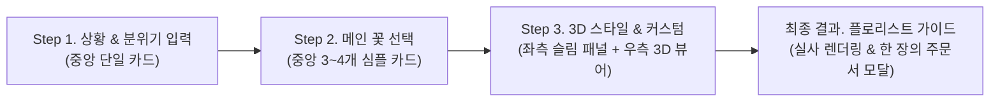

# 🎨 DESIGN.md — Darte Flores (다르테 플로레스) UI/UX 디자인 시스템 & 가이드라인

> **핵심 철학 (Core Design Philosophy):**  
> **"한 화면에 하나의 질문, 하나의 행동 (One Screen, One Focus)"**  
> 사용자가 화면을 봤을 때 *"정보가 너무 많아서 뭐부터 해야 하지?"*라고 고민하는 순간을 완전히 제거합니다. 토스(Toss)나 에어비앤비(Airbnb)처럼 **점진적 공개(Progressive Disclosure)** 원칙을 적용해, 지금 당장 결정해야 하는 핵심 요소만 전면에 보여주고 부가 정보(상세 설명, 영문명, 단가 계산식 등)는 사용자가 클릭하거나 호버했을 때만 자연스럽게 드러나도록 설계합니다.

---

## 1. 핵심 UX 원칙 (Anti-Clutter & De-duplication Rules)

기존 프로토타입의 복잡함과 중복을 해결하기 위해 아래 **5가지 절대 규칙**을 모든 컴포넌트에 강제합니다.

### ① 단계별 화면 분리 (Focused Wizard Layout)
* **금지 사항:** Step 1부터 아직 꽃도 고르지 않았는데 빈 3D 캔버스나 복잡한 사이드바를 띄워두지 않습니다. 또한 이전 단계의 설정값 요약 박스를 화면 상단이나 사이드에 계속 고정해 두지 않습니다.
* **해결책:**
  * **Step 1 (상황 입력) & Step 2 (메인 꽃 선택):** 3D 캔버스 없이 **화면 중앙의 깔끔한 단일 카드(Max-width `680px`)** 레이아웃으로 시선을 중앙에 집중시킵니다.
  * **Step 3 (3D 스타일 & 꽃 커스텀 통합):** 이 단계에서 비로소 **좌측 심플 컨트롤 패널(380px) + 우측 3D 뷰어(나머지 영역)**의 분할 레이아웃으로 전환됩니다.
  * **Step 4 (플로리스트 주문 가이드):** 완성된 꽃다발과 주문서에만 집중할 수 있는 **깔끔한 단일 시트(Modal 또는 Full-page Card)** 형태로 보여줍니다.

### ② Step 3(스타일 비교)와 Step 4(커스텀)의 중복 제거 및 통합
* **문제점:** 기존에는 Step 3에서 스타일별 꽃 리스트를 다 보여주고, Step 4로 넘어가서 또 똑같은 꽃 리스트를 보여주며 바꿔 끼우게 해서 똑같은 UI가 두 번 반복되었습니다.
* **해결책:** **'스타일 선택'과 '꽃 바꿔 끼우기'를 하나의 단계(새로운 Step 3: 3D 스타일 & 커스텀)로 통합**합니다.
  * 좌측 패널 상단에 `[Style A. 로맨틱 파스텔]` `[Style B. 모던 비비드]` `[Style C. 내추럴 가든]` **세그먼트 탭(Segmented Control)**만 심플하게 배치합니다.
  * 탭을 누르면 즉시 3D 꽃다발이 바뀌고, 바로 아래에 있는 **단 하나의 꽃 구성 리스트**에서 원하는 꽃만 클릭해 교체하거나 수량을 조절할 수 있게 하여 중복 화면을 완전히 없앱니다.

### ③ 카드 내 정보 다이어트 (Card Content Diet)
* **문제점:** 꽃 카드마다 한글명, 영문명, 꽃말, 추천 이유(2~3줄), 송이당 단가, 수량, 대체 꽃까지 한꺼번에 적혀 있어 텍스트 공해(Wall of Text)가 발생합니다.
* **해결책 (카드당 최대 3가지 정보만 기본 노출):**
  * **Step 2 (메인 꽃 선택 카드):**
    * **기본 노출:** `컬러 스와치 원형 아이콘` + `꽃 한글 이름 (굵게)` + `🌸 꽃말 한 줄 뱃지`
    * **클릭(선택) 시에만 아코디언처럼 부드럽게 펼쳐지는 영역:** *"이 기념일에 추천하는 이유 (1~2문장 요약)"* 및 예상 단가. 영문명(`nameEn`)은 과감히 생략하거나 아주 작은 캡션으로만 처리합니다.
  * **Step 3 (꽃다발 구성 슬롯 리스트):**
    * **기본 노출 (1줄 컴팩트 로우):** `[역할 점 아이콘]` + `꽃 한글 이름` + `꽃말 짧은 태그` + `우측 [- 3송이 +] 스테퍼`
    * **클릭 시에만 열리는 인라인 드로어(Drawer):** 해당 꽃을 다른 꽃으로 바꾸고 싶을 때 카드를 클릭하면, 그 아래에 교체 가능한 추천 꽃 칩(`swapCandidates`) 3개가 깔끔하게 나타납니다.

### ④ 한 화면에 단 하나의 Primary CTA 버튼
* 화면 하단(또는 패널 하단)에는 사용자가 다음에 눌러야 할 **가장 중요한 버튼(`#BF6C8B` Turkish Rose 배경) 딱 1개**만 눈에 띄게 배치합니다.
* 이전 단계로 돌아가는 버튼은 상단 좌측의 심플한 텍스트/아이콘 버튼(`← 이전으로`) 하나로 통일하고, 부가 기능(히스토리 등)은 초기 화면에서 숨깁니다.

### ⑤ 상단 헤더(Header) 극단적 단순화
* **높이 `56px`의 미니멀 헤더:**
  * **좌측:** `Darte Flores` 로고 텍스트만 깔끔하게 배치 (서브타이틀은 첫 화면 인트로에서만 보여주고 헤더에서는 제거하여 시각적 노이즈 감소).
  * **중앙:** 숫자 텍스트 나열 대신 아주 얇고 우아한 **점(Dot) 또는 3단계 프로그레스 바(`1. 상황 입력` — `2. 메인 꽃` — `3. 3D 꽃다발 완성`)**만 표시.
  * **우측:** 아무것도 두지 않거나, Step 3에서만 현재 예상 총액(`52,000원`) 알약 배지 하나만 깔끔하게 표시.

---

## 2. 컬러 & 타이포그래피 시스템 (Color & Typography Tokens)

화려한 색상을 남발하지 않고, **여백(Whitespace)과 뉴트럴 배경을 85% 이상** 사용하여 실제 꽃의 색상이 주인공이 되도록 합니다.

| 토큰 역할 (Role) | 컬러명 / 값 | 적용 규칙 (Usage Rule) |
| :--- | :--- | :--- |
| **Canvas & Page BG (85%)** | **Petal White** (`#F5F4ED`) | 앱 전체 배경 및 3D 뷰어 배경. 카드 밖의 넓은 여백을 형성하여 눈의 피로도를 낮춤. |
| **Card Surface (10%)** | **Pure Cream / Bone** (`#FFFFFF` ~ `#EFE9DC`) | 기본 카드는 깨끗한 화이트(`#FFFFFF`)에 아주 옅은 보더(`#E7DBC1`)를 사용하고, 선택된 카드나 보조 박스에만 `#E7DBC1`(Bone)을 20~40% 투명도로 은은하게 깔아줌. |
| **Primary Accent (5%)** | **Turkish Rose** (`#BF6C8B`) | **오직 Primary CTA 버튼, 현재 선택된 카드의 테두리(2px), 그리고 핵심 '꽃말' 텍스트 강조에만 사용.** (남용 금지) |
| **Botanical Safe** | **Tea Green** (`#CCDFAA`) | 예산 안정권 표시 점(Dot) 또는 완료 상태 아이콘에만 제한적으로 사용. |
| **Budget Warning** | **Marigold Orange** (`#F6A93A`) | 설정 예산을 초과했을 때 금액 텍스트 옆에 작게 뜨는 알림 점/배지에만 사용. |
| **Primary Text** | **Deep Charcoal** (`#2D2A26`) | 타이틀 및 꽃 이름. 가독성이 뛰어난 고대비 다크 차콜. |
| **Secondary Text** | **Warm Muted Gray** (`#7A746E`) | 부연 설명, 가격, 비활성 탭 텍스트. 본문과 명확한 위계 차이를 둠. |

### 타이포그래피 위계 (Typography Hierarchy)
* **질문 타이틀 (Step Heading):** `24px` (`text-2xl`), `font-bold`, 줄간격 여유 있게. 항상 **사용자에게 말을 건네는 친절한 한 문장 질문** 형태로 작성합니다.
  * 예: *"어떤 날을 위한 꽃다발인가요?"*, *"가장 마음을 끌리는 메인 꽃을 골라주세요."*
* **서브 가이드 (Step Subtitle):** `14px` (`text-sm`), `#7A746E`, 최대 1줄을 넘지 않게 작성.
* **카드 타이틀 (꽃 이름):** `18px` (`text-lg`), `font-semibold`, `#2D2A26`.
* **꽃말 태그:** `13px` (`text-xs`), `font-medium`, `#BF6C8B`, 배경은 `#BF6C8B/10` (연한 로즈빛 알약 형태).

---

## 3. 단계별 화면 상세 설계 (Step-by-Step Wireframe & UX)

전체 플로우를 기존 5단계에서 **직관적인 3단계 위저드 + 최종 결과 모달**로 압축합니다.

---

### [Step 1] 상황 & 분위기 입력 — *"어떤 날을 위한 꽃다발인가요?"*
* **레이아웃:** 화면 정중앙에 위치한 `max-w-xl` (`576px`) 크기의 깔끔한 카드 1개. 주변은 모두 `#F5F4ED` 여백.
* **화면 구성 요소 (위에서 아래로 시선이 자연스럽게 흐르도록 3가지만 배치):**
  1. **기념일 칩 선택:** 큼직하고 누르기 편한 라운드 알약 버튼들 (`졸업식`, `어버이날`, `연인의 생일`, `브라이덜 샤워`, `연주회`, `+ 직접 입력`). 클릭 시 `#BF6C8B` 솔리드 컬러로 명확히 하이라이트.
  2. **예산 슬라이더:** 심플한 가로 슬라이더 바 1개와 우측 상단에 크게 표시되는 금액 텍스트 (`50,000원`). 복잡한 눈금 텍스트는 제거.
  3. **분위기 사진 첨부 (선택 사항 - 접이식/컴팩트 영역):**
     * 거대한 드래그앤드롭 박스 대신, **`[📷 주인공이나 장소의 분위기 사진이 있다면 추가해 보세요 (선택)]`** 형태의 깔끔한 높이 `64px` 배너 버튼으로 배치.
     * 사진을 올리면 배너가 **업로드된 썸네일(48x48) + 추출된 컬러 원형 칩 4개 + 한 줄 무드 키워드**로 심플하게 바뀜. (무관한 사진일 경우 부드러운 한 줄 안내 토스트 표시).
* **하단 CTA:** 카드 하단 전체 너비를 채우는 큼직한 버튼 **`[어울리는 꽃 추천받기 →]`**

---

### [Step 2] 메인 꽃 & 꽃말 선택 — *"주인공이 될 메인 꽃을 하나 골라주세요"*
* **레이아웃:** 화면 중앙(`max-w-2xl`)에 **3개(또는 4개)의 꽃 카드**만 깔끔하게 나열.
* **상단 컨텍스트 바 (최소화):** 이전 단계 설정값들을 주저리주저리 나열하지 않고, 질문 타이틀 바로 위에 작은 캡션 한 줄(`"졸업식 · 예산 5만원 기준 추천"`)과 `[수정]` 텍스트 링크만 둡니다.
* **꽃 카드 디자인 (Progressive Disclosure 적용):**
  * **선택 전 (기본 상태):**
    * 좌측: 꽃의 대표 색상을 보여주는 우아한 원형 컬러 스와치 (`40px`)
    * 중앙: **꽃 한글 이름** (`작약`) + 그 옆에 **`"수줍음, 새로운 시작"` 꽃말 뱃지**
    * 우측: 라디오 체크 원형 아이콘
    * *(이 상태에서는 긴 추천 이유나 단가 계산식을 숨겨서, 사용자가 오직 '꽃 이름'과 '꽃말', '색감'에만 집중해 직관적으로 고를 수 있게 합니다.)*
  * **클릭 시 (선택된 상태):**
    * 카드의 테두리가 `#BF6C8B`로 강조되면서, 카드 하단이 부드럽게 펼쳐지며 **추천 이유 한 줄 요약**(`"졸업식의 설레는 출발을 가장 풍성하고 화사하게 축하해 줄 수 있는 꽃이에요."`)과 예상 송이당 단가가 나타납니다.
* **하단 CTA:** 메인 꽃을 하나 클릭하면 활성화되는 **`[이 꽃으로 3D 꽃다발 보기 →]`** 버튼.

---

### [Step 3] 3D 스타일 & 인터랙티브 커스텀 (Step 3 + Step 4 통합 화면)
사용자가 가장 오래 머무는 핵심 화면이지만, **좌측 패널의 정보 밀도를 절반 이하로 줄여** 3D 꽃다발 감상을 방해하지 않습니다.

* **전체 레이아웃 (Desktop 기준 12컬럼 그리드):**
  * **좌측 컨트롤 패널 (4컬럼, 약 `380px` 고정폭):** 스크롤 없이 한눈에 들어오는 심플한 조작부.
  * **우측 3D 뷰어 스테이지 (8컬럼, 나머지 전체 영역):** 시원하게 트인 3D 꽃다발 캔버스.

#### 1) 좌측 컨트롤 패널 구성 (위에서 아래로 딱 4블록)
1. **상단: 3가지 스타일 탭 (Segmented Control)**
   * `[로맨틱 파스텔]` | `[모던 비비드]` | `[내추럴 가든]` 3개의 탭 버튼.
   * 탭을 누르면 즉시 우측 3D 꽃다발 전체 조합과 포장지 색상이 바뀝니다. 스타일에 대한 긴 설명 텍스트는 제거하고, 1줄 요약(`"부드러운 핑크와 크림 톤의 조화"`)만 탭 바로 아래에 작게 표시합니다.
2. **중단: 꽃다발 구성 리스트 (컴팩트 슬롯 리스트 - 최대 4~5개 행)**
   * 각 행(Row)은 높이 `52px` 내외의 깔끔한 한 줄 카드로 구성됩니다:
     * `[컬러 점] 장미 (메인) · "열렬한 사랑"` — 우측에 `[- 3 +]` 수량 조절 버튼
     * `[컬러 점] 프리지아 · "당신의 시작을 응원해"` — 우측에 `[교체 ▾]` 및 `[- 5 +]`
   * **꽃 교체(Swap) 인터랙션:** 사용자가 서브 꽃이나 그린 소재 행을 클릭(또는 `[교체 ▾]` 클릭)하면, **다른 팝업이나 복잡한 화면 전환 없이 해당 행 바로 아래에 작은 서랍(Accordion Drawer)이 열리며 교체 가능한 추천 꽃 3종이 가로 칩 형태로 나타납니다.** 클릭 시 즉시 3D 모델이 바뀝니다.
3. **하단 옵션: 포장지 & 리본 컬러 (1줄 컬러 칩)**
   * 복잡한 컬러 피커 대신, 플로리스트가 가장 많이 쓰는 **엄선된 5가지 감성 포장지 컬러 원형 버튼(크림, 베이지, 로즈핑크, 세이지그린, 차콜블랙)**을 한 줄로 배치하여 원클릭으로 변경합니다.
4. **패널 최하단 고정 바 (Sticky Footer): 예산 & 최종 CTA**
   * 좌측에 `예상 금액 52,000원` (마우스 호버 시에만 *"꽃 45,000원 + 기본 포장비 7,000원"* 툴팁 표시. 예산 초과 시 주황색 `#F6A93A` 점으로 부드럽게 알림).
   * 우측(또는 전체 폭)에 유일한 Primary CTA 버튼: **`[꽃다발 완성 & 주문서 보기 →]`**

#### 2) 우측 3D 뷰어 스테이지 구성 (Minimal Floating HUD)
* 3D 캔버스 위에는 글자나 박스들을 덕지덕지 띄우지 않습니다.
* **우측 상단:** 아주 작고 깔끔한 반투명 알약 형태의 카메라 시점 전환 아이콘 버튼 3개 (`정면` · `위에서` · `측면`).
* **꽃 호버/클릭 시 (2D ↔ 3D 양방향 연동):**
  * 3D 꽃다발의 특정 꽃 위에 마우스를 올리면 해당 꽃들만 은은하게 빛나며 마우스 근처에 작고 우아한 말풍선(`프리지아 · "새로운 시작"`)만 딱 뜹니다.
  * 클릭하면 좌측 리스트에서 해당 꽃의 교체 서랍이 자동으로 열립니다.

---

### [최종 결과] 실사 프리뷰 & 플로리스트 주문 가이드 (Modal / Sheet)
Step 3에서 `[꽃다발 완성 & 주문서 보기]`를 누르면 열리는 **꽃집 사장님 전달용 최종 화면**입니다. 이 화면 역시 모바일로 꽃집 사장님께 바로 보여드리기 가장 좋도록 **영수증/주문서 카드 형태**로 깔끔하게 정돈합니다.

* **상단 시각 레퍼런스 영역 (탭 또는 나란히 보기):**
  * 기본으로 **방금 만든 3D 꽃다발 스냅샷(정면 + 항공샷)**과 **추출된 컬러 팔레트 칩**이 깔끔하게 표시됩니다.
  * 그 위에 **`[✨ AI 실사 꽃다발 사진으로 변환해보기]`** 버튼이 있어, 원할 때 클릭하면 고화질 실사 꽃다발 이미지가 생성됩니다. (복잡한 버전 히스토리 UI는 제거하고, 심플하게 `[3D 구도 보기 | AI 실사 사진 보기]` 토글 스위치만 제공합니다.)
* **중단: 💬 플로리스트님께 드리는 한 줄 요약 박스 (`#E7DBC1/40` 배경)**
  * 꽃집 사장님이 3초 만에 읽고 이해할 수 있는 핵심 요청문과 **대체 꽃 가이드**:
    > *"위 사진의 **전체 색감과 분위기**를 가장 중요하게 생각합니다. 만약 매장에 특정 꽃 재고가 없다면 아래 표기된 **대체 추천 꽃**으로 자연스럽게 변경해 주세요!"*
* **하단: 한눈에 보는 꽃 레시피 표 & 꽃말 카드**
  * `꽃 이름 (역할)` | `수량` | `재고 없을 시 대체 꽃 추천 (2종)` 만 깔끔한 표로 정리.
* **액션 버튼 2개:** **`[📋 꽃집 문의용 텍스트 복사]`** (카카오톡/문자 전송용) 및 **`[🖨️ 이미지/PDF 저장]`**

---

## 4. 과감하게 덜어낸(삭제/숨김) UI 요소 목록 (What We Removed)

프로토타입을 깔끔하게 만들기 위해 아래 요소들은 화면에서 제거하거나 백그라운드로 숨깁니다.

1. ❌ **상단 최근 작업 히스토리 드롭다운 제거:** 화면 상단을 복잡하게 만들던 세션 히스토리 드롭다운을 제거합니다 (브라우저 새로고침 시 현재 작업 상태만 조용히 자동 유지).
2. ❌ **실사 이미지 다중 버전 히스토리 썸네일 바 제거:** 3D 커스텀 화면에 실사 버전 히스토리 썸네일들이 줄지어 나오는 복잡한 UI를 없애고, 실사 변환은 **최종 완성 단계**에서 깔끔하게 1:1로 확인하도록 단순화했습니다.
3. ❌ **Step 1~2의 불필요한 사이드바 및 빈 3D 영역 제거:** 처음부터 화면을 좌우로 쪼개지 않고, Step 1~2는 중앙 집중형 위저드로 진행합니다.
4. ❌ **카드 내 구구절절한 텍스트 기본 노출 금지:** 영문 꽃 이름(`Peony`, `Freesia` 등), 송이당 단가 곱셈식(`3,500원 × 5송이 = 17,500원`), 긴 추천 사유는 기본 상태에서 숨기고 선택/호버 시에만 최소한으로 보여줍니다.
5. ❌ **중복 스텝 제거:** '스타일 고르기(구 Step 3)'와 '꽃 바꾸기(구 Step 4)'를 하나의 화면으로 합쳐 똑같은 꽃 목록을 두 번 보는 피로감을 없앴습니다.
